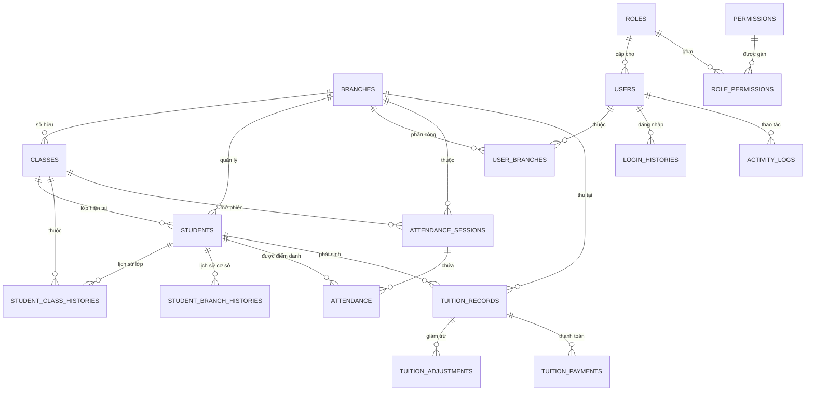

# Thiết kế cơ sở dữ liệu — HappyKidsCK

Tài liệu Giai đoạn 2. File triển khai: `backend/database/migrations/` + `backend/database/seeds/` (xem `backend/database/README.md` để import).

- MySQL/MariaDB · InnoDB · utf8mb4 / utf8mb4_unicode_ci.
- Quy ước: `id` khoá chính tự tăng; bảng danh mục dùng `INT UNSIGNED`, bảng phát sinh dùng `BIGINT UNSIGNED`; mọi bảng nghiệp vụ có `created_at`, `updated_at`; quan hệ khai báo khoá ngoại + index; xoá mềm với học viên; dữ liệu lịch sử/tài chính không xoá cứng.

## 1. ERD

`SYSTEM_SETTINGS` là bảng cấu hình độc lập (không khoá ngoại bắt buộc, chỉ `updated_by`).

## 2. Danh sách bảng

| Bảng | Mục đích | Ràng buộc chính |
|---|---|---|
| `branches` | 2 cơ sở | `code` unique |
| `roles` | 4 vai trò | `role_key` unique |
| `permissions` | Danh mục quyền chi tiết | `permission_key` unique, index `module` |
| `role_permissions` | Gán quyền cho vai trò | PK (role_id, permission_id) |
| `users` | Admin + nhân viên; OAuth/google_id, mật khẩu, khoá tài khoản, avatar | `username`, `email`, `google_id` unique (cho phép NULL) |
| `user_branches` | Phân công 1–2 cơ sở | PK (user_id, branch_id) |
| `login_histories` | Lịch sử đăng nhập (kể cả thất bại) | index user + thời gian |
| `classes` | Lớp theo cơ sở | unique (branch_id, name) |
| `students` | Hồ sơ học viên 13 trường + avatar | `student_code` unique; `identity_code` unique; index cơ sở + trạng thái; xoá mềm |
| `student_class_histories` | Lịch sử gán/chuyển lớp | `left_at` NULL = đang học lớp |
| `student_branch_histories` | Lịch sử chuyển cơ sở | giữ cơ sở đi/đến, người thực hiện |
| `attendance_sessions` | Phiên điểm danh (lớp + ngày + ca) + khoá sổ | unique (class_id, session_date, slot_name) |
| `attendance` | Điểm danh từng học viên trong phiên | unique (session, student); 5 trạng thái |
| `tuition_records` | Học phí 1 học viên / kỳ tháng | unique (student_id, year, month); snapshot cơ sở |
| `tuition_adjustments` | Các khoản giảm trừ | FK record |
| `tuition_payments` | Phiếu thu (nhiều lần) | FK record |
| `activity_logs` | Nhật ký thao tác, lưu diff JSON | index user/thời gian, module/target |
| `system_settings` | Cấu hình (quy định học phí…) | `setting_key` unique |

Bảng bổ sung ngoài danh sách yêu cầu (có lý do): `role_permissions`, `login_histories`, `student_branch_histories` — phục vụ phân quyền chi tiết, lịch sử đăng nhập và "lịch sử chuyển cơ sở" mà danh sách gốc chưa có bảng riêng.

## 3. Ánh xạ 13 trường dữ liệu học viên (bắt buộc giữ đủ)

| # | Trường yêu cầu | Cột CSDL | Kiểu |
|---|---|---|---|
| — | STT (tự động) | `students.id` (hiển thị STT theo danh sách) | INT UNSIGNED AI |
| 1 | Mã HV | `student_code` | VARCHAR(30), unique |
| 2 | Họ và Tên Học Viên | `full_name` | VARCHAR(120) |
| 3 | Ngày Sinh | `dob` | DATE |
| 4 | Giới Tính | `gender` | ENUM male/female/other |
| 5 | Hình Thức / Lớp Học | `study_format` (giữ dữ liệu hồ sơ gốc) + `current_class_id` (liên kết module lớp) | VARCHAR(100) / FK |
| 6 | Mức Học Phí Thỏa Thuận | `monthly_fee` | DECIMAL(12,0) đ/tháng |
| 7 | Họ Tên Phụ Huynh | `guardian_name` | VARCHAR(120) |
| 8 | Số Điện Thoại Liên Hệ | `guardian_phone` | VARCHAR(30), index |
| 9 | Địa Chỉ Thường Trú | `address` | VARCHAR(255) |
| 10 | Ngày Nhập Học | `enrollment_date` | DATE |
| 11 | Trạng Thái Học | `status` | ENUM active/paused/left |
| 12 | Ghi Chú Hồ Sơ / Chuyên Cần | `notes` | TEXT |
| 13 | Mã Định Danh (CCCD/ĐĐ) | `identity_code` | VARCHAR(20), unique, dữ liệu nhạy cảm |
| + | Ảnh học viên (upload từ máy) | `avatar_path` | VARCHAR(255), không lưu URL |

## 4. Ánh xạ trạng thái

| Nhóm | Giá trị CSDL | Ý nghĩa |
|---|---|---|
| Học tập | `active` / `paused` / `left` | Đang học / Tạm nghỉ / Đã nghỉ |
| Điểm danh | `present` | Có mặt |
| | `excused_absent` | Vắng có phép |
| | `unexcused_absent` | Vắng không phép |
| | `late` | Đi muộn |
| | `planned_leave` | Nghỉ có kế hoạch |
| Học phí | `unpaid` / `partial` / `paid` | Chưa thu / Thu một phần / Đã thu đủ |
| Thanh toán | `cash` / `transfer` / `other` | Tiền mặt / Chuyển khoản / Khác |
| Phiên điểm danh | `is_locked` 0/1 | Chưa khoá / Đã khoá sổ |

## 5. Quy tắc toàn vẹn & transaction

1. **Chống trùng điểm danh**: UNIQUE (`attendance_session_id`, `student_id`); phiên duy nhất theo (lớp, ngày, ca).
2. **Khoá sổ**: `attendance_sessions.is_locked`; mở lại phải có quyền + ghi `activity_logs` (old/new).
3. **Chuyển lớp** (transaction): đóng history cũ (`left_at`), thêm history mới, cập nhật `students.current_class_id`.
4. **Chuyển cơ sở** (transaction): thêm `student_branch_histories`, cập nhật `students.branch_id`, đóng lớp cũ nếu thuộc cơ sở cũ. Điểm danh/học phí cũ giữ nguyên nhờ dữ liệu snapshot cơ sở.
5. **Thu học phí** (transaction): thêm `tuition_payments`, cộng dồn `paid_amount`, tính lại `status` (unpaid/partial/paid).
6. **Giảm trừ** (transaction): thêm `tuition_adjustments`, tổng hợp vào `deduction_amount` và tính lại `final_amount`.
7. **Xoá mềm học viên**: set `deleted_at`/`deleted_by`, không xoá dòng; khôi phục = set NULL (ghi log).
8. **Mã HV / CCCD**: unique toàn hệ thống; học viên xoá mềm vẫn giữ mã (khôi phục không đụng độ).
9. Khoá ngoại: RESTRICT cho dữ liệu lịch sử/tài chính (không xoá dây chuyền); CASCADE chỉ cho bảng cấu hình phụ thuộc (role_permissions, user_branches).

## 6. Upload hình ảnh từ máy (theo yêu cầu)

- CSDL **chỉ lưu đường dẫn tương đối** trong các cột `students.avatar_path`, `users.avatar_path`, `branches.logo_path`. Không có cột URL hình ảnh.
- Luồng: form chọn file → backend validate đuôi (jpg/jpeg/png/webp) + MIME thực + dung lượng ≤ 2MB → đổi tên ngẫu nhiên → lưu vào `backend/storage/uploads/<module>/` (ngoài webroot) → ghi path vào CSDL.
- Hiển thị/tải ảnh qua controller kiểm quyền (đọc file từ storage), không phục vụ trực tiếp bằng đường dẫn tĩnh — tránh lộ dữ liệu trẻ.
- Thay ảnh mới: ghi đè bản ghi path và xoá file cũ có kiểm soát.

## 7. Nhật ký & lịch sử

- `activity_logs`: mọi thao tác thay đổi dữ liệu (module, action, target, `old_values`/`new_values` dạng JSON, IP, user agent, thời gian).
- `login_histories`: mọi lần đăng nhập thành công/thất bại (Google hoặc mật khẩu).
- Lịch sử riêng theo nghiệp vụ: chuyển lớp, chuyển cơ sở, giảm trừ, thanh toán.

## 8. Ghi chú triển khai

- Thứ tự import và cách chạy: xem `backend/database/README.md`.
- Seed sẵn: 2 cơ sở, 4 vai trò, 29 quyền, tài khoản Super Admin tạm (dev — đổi email Google/mật khẩu trước khi vận hành thật).
- Các điểm còn chờ Admin xác nhận trước khi code giai đoạn 3–7: email Google admin, công thức học phí, ca/buổi học, quy tắc Mã HV, lịch backup (xem `docs/phan-tich-nghiep-vu.md` mục 6).
